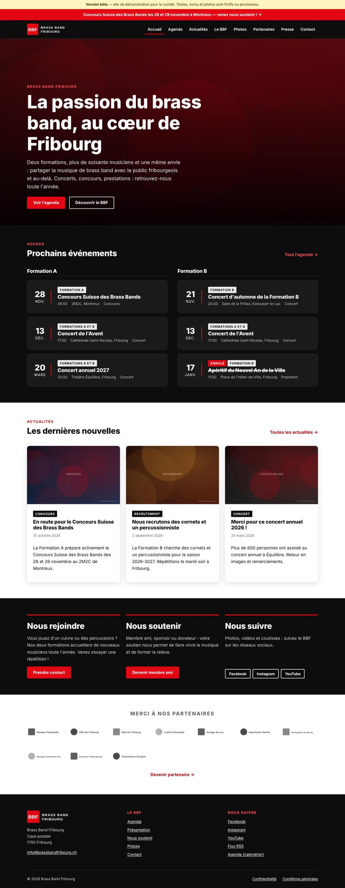
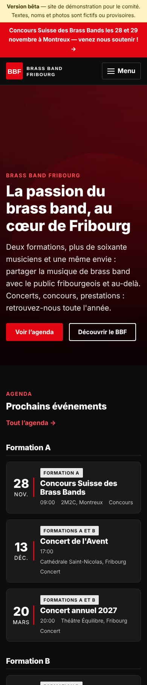
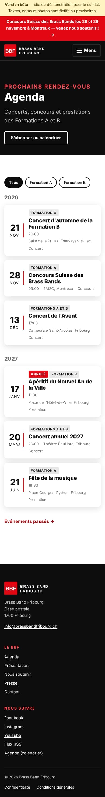
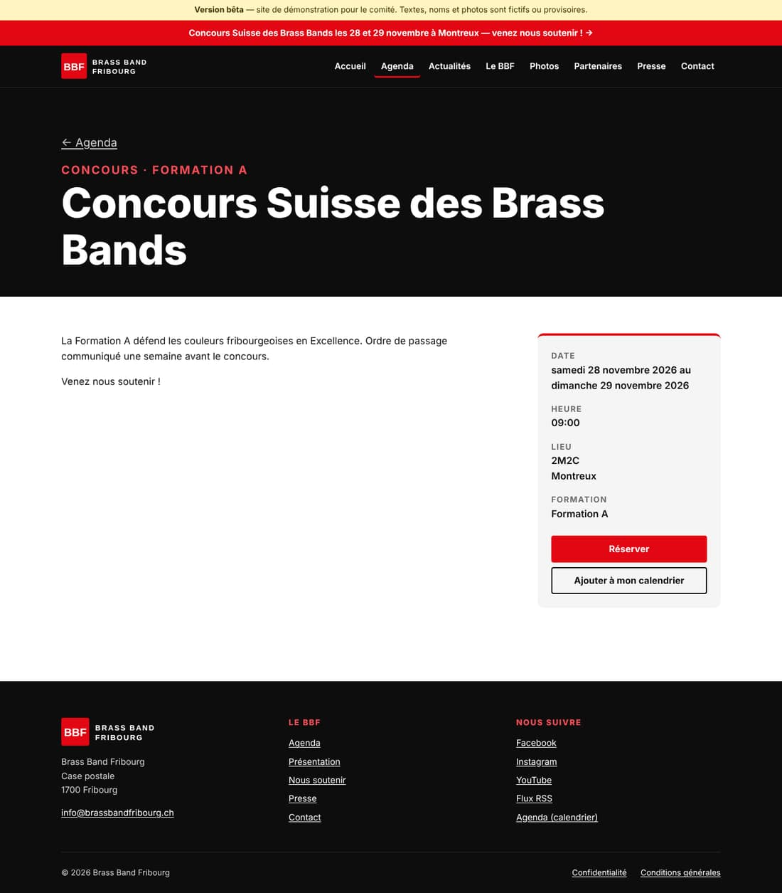
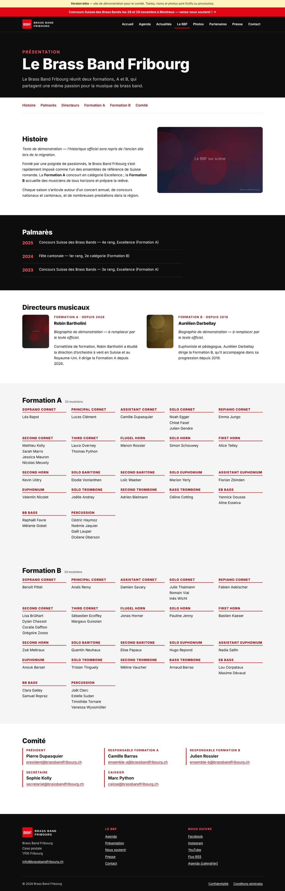
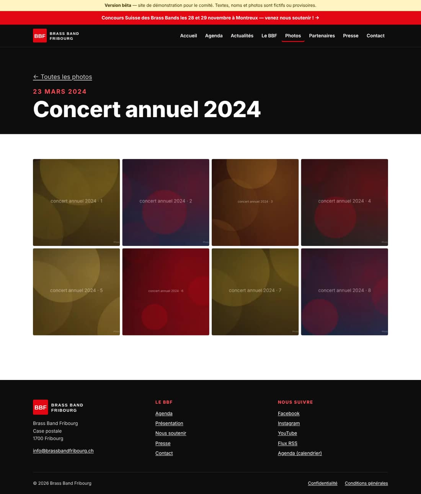

# Nouveau site du BBF — version bêta pour le comité

*22 octobre 2026*

## En deux phrases

La bêta du nouveau site est fonctionnelle : toutes les pages du cahier des charges existent, l'interface d'administration en français est configurée, et la chaîne « je clique sur Publier → le site est à jour » est prête. Il manque les vrais contenus (migration de l'ancien site), la charte officielle (logo SVG, polices) et l'ouverture des comptes au nom du BBF.

## Ce que vous pouvez montrer

| Page | Adresse | Ce qui est nouveau |
| --- | --- | --- |
| Accueil | `/` | Grande photo, 3 prochains événements par formation, 3 dernières actualités, blocs Rejoindre / Soutenir / Suivre, bandeau partenaires |
| Agenda | `/agenda/` | Filtre Tous / A / B, événements passés archivés automatiquement, « Annulé » affiché, ajout au calendrier (.ics), abonnement à tout l'agenda |
| Fiche événement | `/agenda/…/` | Date, heure, lieu, bouton « Réserver », visible par Google comme événement |
| Actualités | `/blog/` | Filtre par catégorie, 12 par page, flux RSS ; les anciennes adresses d'articles sont conservées |
| Le BBF | `/presentation/` | Histoire, palmarès, directeurs, effectifs A et B **triés automatiquement par pupitre**, comité |
| Photos | `/gallery/` | Albums + visionneuse plein écran (clavier, glisser sur mobile) |
| Partenaires, Presse, Contact | | Logos par catégorie, kit presse, adresses par fonction protégées contre le spam |
| Bandeau d'annonce | en haut | Activable depuis l'admin, disparaît seul à la date choisie |

Le bandeau jaune « Version bêta » rappelle que **tous les noms, textes et photos sont fictifs** (y compris les 66 musiciens et le comité). Rien n'est repris de l'ancien site à ce stade.

## Qualité mesurée sur la bêta

- **Accessibilité** : 0 violation sérieuse ou critique (axe-core, WCAG 2.2 AA) sur 13 pages, ordinateur et mobile.
- **HTML** valide sur toutes les pages, **0 lien interne cassé**.
- **Aucun cookie, aucun traceur**, aucune ressource chargée chez un tiers → pas de bannière cookies.
- **JavaScript** : environ 5 Ko pour tout le site.
- **Sécurité** : en-têtes HTTP stricts prêts (CSP, HSTS…) ; aucune adresse privée publiée.
- 18 tests automatiques (tri des pupitres, heure suisse été/hiver, agenda, calendrier).

## Décisions provisoires prises pour avancer

Le cahier des charges laissait ces points ouverts ; voici le choix retenu pour la bêta. **Chacun se change en quelques minutes** si le comité décide autrement.

| Question ouverte | Choix provisoire |
| --- | --- |
| Polices Gilroy / Graphik (licence web ?) | Polices système en attendant ; emplacements prêts, aucune police non licenciée publiée |
| Logo SVG et codes couleurs exacts | Logo provisoire « BBF » ; rouge `#E30613`, noir `#0D0D0D` (à remplacer par les valeurs officielles) |
| `brassbandfribourg.ch` ou `www.` ? | Domaine nu `brassbandfribourg.ch`, `www` redirigé |
| Adresses de fonction | `president@`, `ensemble-a@`, `ensemble-b@`, `secretariat@`, `caisse@`, `presse@`, `info@` |
| Téléphones du comité | Non affichés (case à cocher par personne dans l'admin) |
| Noms des musiciens | Affichés, mais une case « Actif » permet de retirer quelqu'un ; accord à recueillir |
| Hébergement de la bêta | Rien n'est en ligne tant que les comptes BBF n'existent pas (voir étapes) |

## Ce que le comité doit faire maintenant (phase 0)

1. Créer l'organisation GitHub `brassbandfribourg` (adresse it@brassbandfribourg.ch, double authentification obligatoire) et désigner 2–3 administrateurs.
2. Commander l'**Hébergement Web Infomaniak** (pas Starter) et créer `nouveau.brassbandfribourg.ch` pour la recette.
3. Fournir le logo en SVG, les codes couleurs, et confirmer la **licence web** des polices.
4. Obtenir l'**export de l'ancien WordPress** (ou l'accès à l'hébergement actuel).
5. Désigner 2 éditeurs « test » pour la recette.

Dès que 1 et 2 sont faits, la bêta est en ligne sur `nouveau.brassbandfribourg.ch` en moins d'une heure (procédure dans `docs/RUNBOOK.md`).

## Calendrier proposé

| Étape | Objectif |
| --- | --- |
| Validation de la bêta par le comité | Fin octobre |
| Comptes + export WordPress | Début novembre |
| Migration des contenus, recette par 2 éditeurs | Mi-novembre |
| Mise en ligne | **Avant le Concours Suisse des 28–29 novembre**, pour en profiter côté visibilité |

## Coût

Environ **CHF 6–7 par mois** (hébergement Infomaniak). GitHub, Cloudflare et Sveltia : gratuits. Le domaine est déjà payé.

## Captures

| Accueil (ordinateur) | Accueil (mobile) | Agenda (mobile) |
| --- | --- | --- |
|  |  |  |

| Fiche événement | Le BBF | Album photo |
| --- | --- | --- |
|  |  |  |

## Voir la bêta sur son ordinateur

```bash
npm ci && npm run build && npm run preview   # puis ouvrir http://localhost:4321
```

L'admin peut aussi être essayée **sans aucun compte** : ouvrir `http://localhost:4321/admin/` dans Chrome ou Edge, choisir « Travailler avec un dépôt local » et sélectionner le dossier du projet. Les modifications sont alors écrites directement dans les fichiers.
